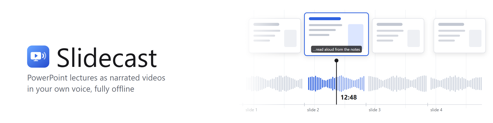

<picture>
  <source media="(prefers-color-scheme: dark)" srcset="docs/banner-dark.png">
  
</picture>

  
  
  
  

Turn a PowerPoint deck into a narrated video, fully offline. Each slide's **speaker notes** are
read aloud in **your own cloned voice** (Chatterbox-Turbo), and the slides and narration are
encoded into a single AV1 or HEVC video with subtitles.

Built for long lecture decks - a series of 90-minute lectures is the everyday workload. Finished
work is kept, so after editing the notes of three slides, only those three are recorded again.

## What it does

- **Your voice from a short sample.** 10-20 seconds of clean speech is enough to clone a voice.
  Audition a test phrase before processing a whole lecture.
- **Animations, transitions and embedded videos are kept** when Microsoft PowerPoint is
  installed: every slide is rendered the way PowerPoint plays it. A video with its own sound
  waits until the narration has finished; a silent video or GIF keeps looping for as long as the
  slide is on screen. Without PowerPoint, slides become still images.
- **One button.** *Make video* goes from the deck to the finished file: slides, narration, encoding.
- **Whole folders at once.** Point it at a folder of decks (subfolders included) and it processes
  every one with a single model load, skipping decks whose video is already up to date.
- **Edit the narration in the app.** Change a slide's notes, exclude slides, re-record just one
  slide, and listen to each slide's audio before encoding.
- **Clean sound.** Silence trimming, smooth joins, and the whole track evened out to a steady
  loudness.
- **Subtitles included.** Every video comes with `.srt` and `.vtt` subtitles timed to the
  narration.
- **Pause and resume** any long run; finished slides are never lost, even when cancelling.
- **Nothing leaves your PC.** After the one-time model download, everything runs offline.

## What you need

- **Windows 10 or 11**, 64-bit.
- **An NVIDIA graphics card** with 3 GB of video memory or more and a recent driver. Without one
  Slidecast still works, just much more slowly.
- **About 15 GB of free disk space** and an internet connection for the installation.
- **Microsoft PowerPoint** (optional) - only needed to keep animations, transitions and videos
  that are embedded in slides. Without it, slides become still images.

Everything else - LibreOffice, ffmpeg and the voice model - is installed for you.

## Install

1. Download `Slidecast-<version>.zip` from the
   [Releases](../../releases) page (the newest is at the top).
2. Unpack it to a folder whose path has no spaces or non-Latin letters, e.g. `C:\Slidecast`.
3. Double-click **`Install.cmd`**. It downloads everything Slidecast needs (about 10 GB, so it
   takes a while), checks your graphics card and adds a **Slidecast** shortcut to the Desktop and
   the Start menu. At the end it lists what it found, each line marked `[ok]`.

Then open Slidecast from the Desktop or the Start menu. After the installation it works offline.

If the installation stops with an error, check the internet connection and run `Install.cmd`
again - it continues where it stopped. Running it again later also repairs the installation.

**To uninstall**, delete the Slidecast folder and the two shortcuts. LibreOffice and ffmpeg stay
installed; remove them in *Settings > Apps* if you do not need them.

## How to use it

The steps on the left go top to bottom:

1. **Decks** - drop a `.pptx` into the window or press *Browse for deck*. You get a table of slides
   with a preview, the notes, the expected length and the state of each slide. Double-click a slide
   to edit its narration; right-click for more (re-record, play, include/exclude, reset notes).
   Switch to **Folder (batch)** to process a whole folder of decks.
2. **Voice** - choose the reference recording of your voice, then press *Synthesize test phrase* to
   hear how it sounds. *Expressiveness* and the pauses between sentences and slides can be tuned
   here.
3. **Synthesis** - see how much of the narration is ready and preview how each slide's notes will
   be read, split into parts.
4. **Export** - video quality and size, codec, audio, and the output folder, with a live estimate
   of the file size.
5. **Rebuild** - redo just one part of a video (slides, narration, the final video) or free disk
   space. Enter slide numbers such as `3, 7, 12-15` to re-record only those slides.

Press **Make video** in the Decks step to do everything in one go. The status bar shows progress
and the time left, with **Pause** and **Cancel**.

The settings in Voice, Synthesis and Export can be changed with no deck open: they then become the
defaults for new decks and for folder runs.

## Where the files go

Slidecast creates a folder next to each deck, `<deck name>_slidecast`. The finished video is in
its `output` folder (or in the output folder you chose in Export), together with the subtitles.

Keep this folder: it holds the narration that is already recorded, which is what makes a second
run fast. To free disk space, use the **Rebuild** step rather than deleting files by hand.

## Writing the speaker notes

- Bullets, numbering and formatting are removed; each line is read as a sentence.
- Web addresses are read aloud ("example dot com") or skipped - your choice in Synthesis.
- Common abbreviations (e.g., mg, GPU) are expanded - can be switched off in Synthesis.
- `[laugh]`, `[chuckle]` and `[cough]` in the notes are performed by the voice.
- Slides without notes stay on screen silently for a few seconds (adjustable in Voice).
- Hidden slides are left out.

## Troubleshooting

- **"LibreOffice was not found"** or **"ffmpeg was not found"** - run `Install.cmd` again; it
  installs whatever is missing. If you installed them yourself somewhere unusual, show Slidecast
  where they are via *File → Set LibreOffice path* / *Set ffmpeg path*.
- **The window stays blank or does not open** - Slidecast needs the Microsoft Edge WebView2
  runtime, which Windows 11 already has; on Windows 10 install it from
  [microsoft.com](https://developer.microsoft.com/microsoft-edge/webview2/).
- **"Access is denied" while saving audio** - OneDrive, Dropbox or an antivirus is holding the
  file. Slidecast retries automatically; if a slide still fails, run again and it is picked up.
  It is best to keep decks outside synced folders and only put the finished video there.
- **A slide's video talks over the narration** - turn on *Play slide videos after the narration* in
  Export (it is on by default).
- **An embedded video has no sound** - it is muted in the deck itself (PowerPoint → Playback →
  Volume).
- **Animations are missing** - PowerPoint is not installed, so slides were made as still images.
- **Out of graphics memory** - close other programs using the GPU, lower the chunk size in
  Synthesis, or set *Processor* to `cpu` in Voice.
- **Reference clip rejected** - it must be longer than 5 seconds; only the first 10 seconds are
  used. Use clean speech without music or noise.
- **The MP4 plays without sound in some players** - choose AAC audio in Export (the MP4 default),
  or use the MKV container.
- **The first run of an animated deck is slow** - PowerPoint renders every slide in real time.
  This happens once; later runs reuse the result.
- Every run writes a log to `<deck name>_slidecast/logs/slidecast.log`; the **Log** button in the
  window shows it too.

## License

[MIT](LICENSE). © 2026 Edgars Edelmers. Chatterbox-Turbo is MIT-licensed by Resemble AI; LibreOffice and
ffmpeg carry their own licenses.

## Contact

Edgars Edelmers – edgars.edelmers@disroot.org, or open an [issue](https://github.com/edlmar/Slidecast/issues).
